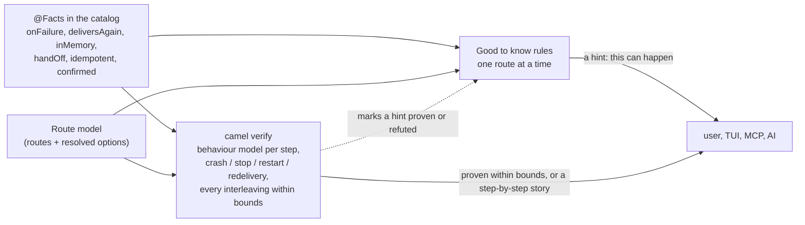

# camel verify: check a Camel integration for lost and duplicated messages before it runs


*The run it shows is a real counterexample from the model of section 4.1, confirmed by a test.*

A proposal for a command that reads a user's routes, with the options of their endpoints, and checks them for
end-to-end delivery guarantees under crashes, graceful stops and redelivery: can a message be lost, can a side effect
happen twice, can request-reply over `seda` deadlock, does every aggregation group complete, does one transaction
cover both the write and the send. When the answer is no, it prints the run that breaks it as a short story, step by
step. When it is yes, it says "no counterexample within these bounds" and names the guarantee the route gives:
at-most-once, at-least-once or effectively-once.

It is meant as the exhaustive checker behind Claus's Good to know design (CAMEL-26716, `design/good-to-know.adoc`),
using the same `@Facts`. It is not a second rule system.

**Status:** shared early for feedback on the direction. Building it comes after the exchange sanitizer work is done
(section 9).

Every statement carries one of four labels:

- *(checked)*: read on apache/camel main `dcb17ac19f96` (2026-11-11), or in the example source linked;
- **model**: a TLC result on a hand-written TLA+ model in [`models/`](models/);
- **tested**: reproduced by a JUnit test on released Camel 4.23.0 in [`tests/`](tests/);
- **design**: written down, not built. There is no prototype of the command yet.

## 1. The problem

The camel-quarkus-examples project has an example called `jpa-idempotent-repository`
([route](https://github.com/apache/camel-quarkus-examples/blob/0b6b39810b9ed845f933184f1fa739cba9ee726d/jpa-idempotent-repository/src/main/java/org/acme/jpa/idempotent/repository/JpaIdempotentRoute.java#L57-L73)).
It reads files, skips a file whose body was seen before, and calls a costly HTTP API once per distinct body:

```java
from("file:target/input-files")
    .idempotentConsumer(simple("${body}")).idempotentRepository("jpaIdempotentRepository")
    .toF("http://localhost:%s/costly-api-call", port);
```

The idempotent consumer is eager by default: it stores the key before the rest of the route runs *(checked)*. The JPA
repository commits each key in its own transaction *(checked)*. The file is moved to `.camel` only when the exchange
completes *(checked)*. Each of these is documented. Put together, with a crash at the wrong moment:

1. `f3` (body `B`) is read. Key `B` is stored and committed.
2. The JVM dies before the API call. `f3` is still in the inbox.
3. After the restart `f3` is read again. Key `B` is in the repository, so `f3` is a duplicate and is skipped.
4. The exchange completes normally and `f3` is moved to `.camel`.

The API never got `B`. Nothing failed, so nothing is logged. **model** and **tested** (`R1IdempotentCrashTest` halts a
child JVM at that step: the API log ends as `[A]`).

Turning eager off does not fix it. The key is then stored after the call, so a crash between the two calls the API
twice for `B` (**model**, **tested**: `[A, B, B]`). With a target that does not ignore a repeat, no setting of this
route gives exactly-once. That is a fine trade-off to make on purpose. It is hard to see by reading the route.

## 2. What `camel verify` would print (design)

```
$ camel verify JpaIdempotentRoute.java

Route    file:target/input-files -> idempotentConsumer(${body}) -> http:costly-api-call
Using    jpaIdempotentRepository = JpaMessageIdRepository (persistent, from the @Produces method)
         idempotentConsumer eager=true (default), removeOnFailure=true (default)
         file: moved to .camel on completion, left in place on failure
World    3 files (2 with the same body), at most 1 crash, at most 1 failed call

NoLoss              FAILED   counterexample below (173 states)
NoDuplicateEffect   ok       no counterexample within bounds (224 states)

Guarantee: at-most-once. A file can be moved to .camel without the API ever getting its body.

How it happens (8 steps):
  1. f1 (body A) is read. Key A is stored.
  2. The API is called with A.
  3. The exchange completes. f1 is moved to .camel.
  4. f2 (body A) is read. Key A is already stored: f2 is skipped as a duplicate and moved to .camel.
  5. f3 (body B) is read. Key B is stored (eager=true).
  6. The JVM crashes before the API call. f3 stays in the inbox.
  7. The application starts again.
  8. f3 is read again. Key B is already stored: f3 is skipped as a duplicate and moved to .camel.
  The API never got B. No error was logged.

Other settings, same world:
  eager=false               at-least-once: a crash after the call and before the key is stored calls the API twice
  memory repository         at-least-once: the keys are gone after a crash, so B can be sent again
  effectively-once needs    eager=false, and an API that ignores a repeated B
```

The numbers and the story are what TLC gives for [`models/R1_IdempotentFileHttp.tla`](models/R1_IdempotentFileHttp.tla)
(**model**), turned into text by [`tools/story.py`](tools/story.py). The command, the header lines and the "Other
settings" block are **design**: they are written by hand from the four variants in `models/RESULTS.txt`.

## 3. How it fits with Good to know

Claus's design (`design/good-to-know.adoc`, CAMEL-26716, status proposed *(checked)*) asks the same questions a
newcomer has: what happens when it fails, what can happen twice, what a restart forgets, what does not wait. It puts
the answers in metadata: `@Facts` on each component, EIP, data format and language (`onFailure`, `deliversAgain`,
`inMemory`, `handOff`, `idempotent`, `confirmed`, and more), and one curated rule file in the catalog that every tool
reads. Each fact is verified with camel-chaos or a DST world before it is written, and a missing fact gives no hint.
The same rules later explain a failure when it happens.

That is most of what `camel verify` needs. A behaviour model of a component is the fact table turned into transitions:
`deliversAgain=yes` is "after a restart, the input may give this message again"; `inMemory=yes` is "a crash empties
this"; `handOff=yes` is "the sender goes on before the receiver is done". The rules say where to look. A model checker
can then answer the questions the rules leave open, because they need the order of steps across a crash, or across
routes:



Two cases from the examples show where the two meet:

- In R1 the rule `delivered-again-not-idempotent` is silent, which is right for what it asks: the route has an
  idempotent consumer (`hasNot: [idempotentConsumer]`). The loss comes from the order of "store key" and "call" with a
  crash in between. A state search sees it; a condition over one route would need a new rule for each such order.
- In R4 the proposed `inMemory` fact of `aggregate` is `no` when `aggregationRepository` is set. The example sets it, to
  a `MemoryAggregationRepository` bean. Both the hints and `verify` need the class of the referenced bean, so this is
  something to resolve once and share.

So the proposal is: the same facts, the same route model, and a second reader of them that explores states. A hint
that `verify` proves or refutes for this route can say so, and its counterexample is the "why" the design already asks
for in "Explaining a failure".

## 4. Findings on official examples

Seven routes were checked, five from the official example projects. Each property was checked with at most one crash
and/or one graceful stop, two or three messages, 12 to 354 states, about a second per check (**model**). Wording
note: these are design pitfalls of example routes and their docs, not defects in Camel.

### 4.1 R1: an idempotent consumer drops a file on a crash

Section 1. Source: camel-quarkus-examples
[`JpaIdempotentRoute.java`](https://github.com/apache/camel-quarkus-examples/blob/0b6b39810b9ed845f933184f1fa739cba9ee726d/jpa-idempotent-repository/src/main/java/org/acme/jpa/idempotent/repository/JpaIdempotentRoute.java#L57-L73).

| Variant | NoLoss | NoDuplicateEffect |
|---|---|---|
| as shipped (eager, persistent repository) | violated | holds |
| eager, no crash, 2 failed calls | holds | holds |
| eager=false, persistent | holds | violated |
| eager, memory repository | holds | violated |

**model** for all rows; **tested** for the first three (`R1IdempotentCrashTest`: the crash is `Runtime.halt` in a child
JVM; the JPA repository is replaced by `FileIdempotentRepository`, which also persists in `add`, and the HTTP call by
an fsync'ed append to a log file).

### 4.2 R2: a redeploy loses aggregated input whose file is already committed

Source: camel-quarkus-examples
[`file-bindy-ftp/Routes.java`](https://github.com/apache/camel-quarkus-examples/blob/0b6b39810b9ed845f933184f1fa739cba9ee726d/file-bindy-ftp/src/main/java/org/acme/bindy/ftp/Routes.java#L38-L57).
A file is split, the parts go into an in-memory aggregator with `completionInterval(5000)`, and the groups go over
`seda` to SFTP. The file route completes as soon as the parts are in the aggregator, so the file is moved to `.camel`
while its books are only in memory. A stop within those 5 seconds clears the groups: `forceCompletionOnStop` and
`completeAllOnStop` are not set by default *(checked)*.

| Variant | NoLoss |
|---|---|
| as shipped, crash | violated |
| as shipped, graceful stop | violated |
| `completeAllOnStop`, graceful stop | holds |
| `completeAllOnStop`, crash | violated |
| persistent repository + `seda`, crash | violated (the `seda` queue is in memory too) |
| persistent repository + `direct`, crash | holds |

**model**; **tested** for the first and third rows (`R2FileSplitAggregateStopTest`: no upload and the file in `.camel`
by default; one upload during the stop with `completeAllOnStop`). The test splits lines instead of using bindy and
sends to a mock instead of SFTP. `completeAllOnStop` fixes the graceful stop only.

### 4.3 R4: the aggregate example promises persistence its configuration does not have

Source: camel-examples `aggregate`. The
[README](https://github.com/apache/camel-examples/blob/869cde2a332ab6108572af0b1f93923bc3fc9768/aggregate/README.adoc?plain=1#L54-L56)
says that after `ctrl+c` and a restart the example "remembered previously entered values", from a persistent store.
The [Spring XML](https://github.com/apache/camel-examples/blob/869cde2a332ab6108572af0b1f93923bc3fc9768/aggregate/src/main/resources/META-INF/spring/camel-context.xml#L31)
wires a `MemoryAggregationRepository`. "The sum survives a restart" is violated as shipped and holds with a persistent
repository (**model**). **tested** (`R4AggregateMemoryRestartTest`): enter 1, restart, enter 2, then STOP prints
"The result is: 2", not 3.

### 4.4 Safe cases

- **R5**, camel-examples
  [`aggregate-dist`](https://github.com/apache/camel-examples/blob/869cde2a332ab6108572af0b1f93923bc3fc9768/aggregate-dist/src/main/java/org/apache/camel/example/Application.java#L119-L123):
  two instances aggregate into one JDBC repository with `optimisticLocking()`. No update is lost (**model**). Without
  optimistic locking, updates are lost (**model**). **tested** (`R5AggregateDistributedTest`, 2 contexts, 4 threads,
  60 items, H2): with optimistic locking one completion with all 60 items and no failed send; without it, no
  completion and about half of the sends fail. Liveness was not checked.
- **R6**, camel-quarkus-examples
  [`jms-jpa`](https://github.com/apache/camel-quarkus-examples/blob/0b6b39810b9ed845f933184f1fa739cba9ee726d/jms-jpa/src/main/java/org/acme/CamelRoutes.java#L44-L53):
  a transacted route that sends to JMS and writes with JPA under XA. With a crash before commit both happen or
  neither (**model**); with JMS not enlisted they can split (**model**). **Model only**: no test, since it needs
  Narayana, Artemis and XA. The model assumes the transaction log survives the crash.

### 4.5 Partial and synthetic

- **R3**, camel-quarkus-examples
  [`kafka/Routes.java`](https://github.com/apache/camel-quarkus-examples/blob/0b6b39810b9ed845f933184f1fa739cba9ee726d/kafka/src/main/java/org/acme/kafka/Routes.java#L35-L38):
  Kafka into a `seda` buffer. With auto-commit, a crash or stop can lose the records sitting in `seda` (**model**).
  Only the `seda` half is **tested** (`R3SedaBufferStopTest`); the offset half comes from the source and the client
  docs, with no broker. Demo-scale; weaker to cite.
- **R7**, the request-reply route of the `seda` component docs: no deadlock with one or two consumers (**model**,
  **tested**). A synthetic variant that calls its own queue InOut deadlocks (**model**; **tested** as an
  `ExchangeTimedOutException`). No official example has that cycle.

## 5. How it would work (design)

```
routes ──► RouteModel ──► route trees + catalog options and defaults (+ bean classes where they resolve)
       ──► behaviour model per EIP and component, parameterised by @Facts and options
       ──► environment: crash anywhere, graceful stop (shutdown order), restart, input redelivery, bounded failures
       ──► composed state space ──► search (generated TLA+ for TLC, or an embedded breadth-first search in Java)
       ──► properties ──► verdict + shortest counterexample ──► story
```

1. **Read the routes** with what JBang already has: `RouteModel`, the route trees of any DSL, the catalog for options
   and defaults *(checked: `camel validate` and `ProjectOverview` read the same model)*.
2. **Behaviour models** for each EIP and component that matters for delivery, small and hand-written once, each a few
   dozen lines like the ones in `models/`. Their parameters are facts: the R1 model has `Eager` and `PersistentRepo`;
   the R2 model has `PersistentAgg`, `CompleteAllOnStop` and `SedaHop`. These map onto `inMemory`, `deliversAgain`,
   `handOff` and `onSuccess`.
3. **The environment**: a crash at any step (memory gone, no `onCompletion`), a graceful stop with the default
   shutdown strategy, a restart, the input delivering again what it did not commit, a bounded number of failed calls.
4. **Search** every interleaving within the bounds. Breadth-first, so the first violation found is a shortest one.
   All state spaces of this spike are under 400 states, so an embedded search in Java is enough for M1 and needs no
   TLA+ at run time.
5. **Properties** (section 6), each checked on its own.
6. **The story**: the counterexample as numbered steps in plain words, from a narration per action of each behaviour
   model, as `tools/story.py` does from `narr_R*.json`.

**Configuration that cannot be known statically** (a bean class behind a name, a property placeholder, whether a JMS
connection factory is XA): say "assuming X" and check both branches when it changes the verdict.

**Custom processors**: unknown code gets a pessimistic default (it may fail; it has a side effect that is not
idempotent) unless the user says otherwise with an annotation or a line in the project.

**Credibility**: a wrong fact gives a wrong hint in Good to know; in `verify` it gives a wrong "verified", which is
worse. The answer is the same as the design's: no fact without a test. Each behaviour model should come with a
camel-chaos recipe or a DST world that shows the real component does what the model says, as the tests in `tests/` do
for the spike.

**Time** is not modelled: `completionInterval`, timeouts and delays are "may fire at any moment". A verdict never
depends on a timer being fast enough.

## 6. Properties and how a verdict reads (design)

| Property | Meaning |
|---|---|
| NoLoss | at rest, every message that came in reached its last step (or was parked on purpose) |
| NoDuplicateEffect | a side effect marked not idempotent happens at most once per message |
| NoDeadlock | while a request waits for its reply, some step can still run |
| GroupCompletes | every aggregation group that can form is completed or stays in a store that survives a restart |
| Atomic | the steps inside one transaction all happen or none do, across a crash |

A verdict is either a counterexample, or "no counterexample within bounds" with the bounds printed. NoLoss and
NoDuplicateEffect pull against each other, so the summary line is the guarantee the route gives: **at-most-once**
(no duplicate, loss possible), **at-least-once** (no loss, duplicates possible), or **effectively-once** (no loss, and
the duplicates that can happen hit only idempotent effects).

## 7. Prior art

Nothing found checks a user's concrete integration this way. The pieces exist apart. Details and sources:
[`PRIOR_ART.md`](PRIOR_ART.md).

| Prior art | Covers | Does not cover |
|---|---|---|
| Good to know, [CAMEL-26716](https://issues.apache.org/jira/browse/CAMEL-26716) | hints per route from `@Facts` and rules | crash points, interleavings, cross-route state, counterexamples |
| `camel validate`, camel-report `validate`, RouteTopologyService ([CAMEL-23656](https://issues.apache.org/jira/browse/CAMEL-23656), [CAMEL-26823](https://issues.apache.org/jira/browse/CAMEL-26823)) | schema, URIs, options, unconsumed endpoints, the route graph with reply edges | a failure model |
| camel-chaos ([CAMEL-26330](https://issues.apache.org/jira/browse/CAMEL-26330)) | faults in a running app, lost and redelivered counts | proving that no loss exists |
| Flow linting in other products: [NiFi Flow Analysis Rules](https://www.javadoc.io/static/org.apache.nifi/nifi-api/2.0.0-M2/org/apache/nifi/flowanalysis/package-summary.html), [mule-lint](https://mule-lint.github.io) | rules on the flow definition | exploring executions |
| Fahland and Gierds, [CAiSE 2013](https://doi.org/10.1007/978-3-642-38709-8_26) | EIP designs as coloured Petri nets, model checking with counterexamples | failures, redelivery, transactions, real configuration |
| Ritter, Rinderle-Ma et al. ([EDOC 2018](https://doi.org/10.1109/EDOC.2018.00012), [arXiv 2305.19196](https://arxiv.org/abs/2305.19196)) | EIP semantics with transactions in timed db-nets | crash and redelivery, endpoint options, a user-facing checker |
| [Flux, OSDI 2023](https://www.usenix.org/conference/osdi23/presentation/ding) | idempotence of serverless code under retries | integration routes, loss, aggregation |
| TLA+ and P at AWS, MongoDB, Cosmos DB, Kafka transactions | the platforms' own protocols | user pipelines |

What looks new: the input is the user's routes as written, with their options; the failure model comes from real
component behaviour (file commit on completion, eager keys, auto-commit, in-memory state, shutdown order); the
properties are end to end across routes; and it ships in the Camel CLI. Model checking EIPs is not new, and the
proposal should cite the work above as its base.

## 8. Limits of this spike

- The models are written by hand from the source, not generated from `RouteModel`.
- Bounds are small: one crash and/or one stop, two or three messages. "Holds" means no counterexample within them.
- R3 is half tested, R6 is model only, R7's failing case is synthetic.
- Tests replace parts: JPA by a file repository, bindy by a line split, HTTP and SFTP by a log file or a mock, Kafka by
  `direct`. They run on Camel 4.23.0; the semantics were read on main, on the same code paths.
- Time is not modelled.

## 9. Plan and timing

This is shared early to get feedback on the direction. It will be built after the exchange sanitizer work is
finished: its R2 rule is in review now (#29664), then come the dev console and CLI step, then R3. `camel verify`
starts once those are done. Until then the only work on it is answering feedback on this document.

1. **M1**: five behaviour models (file, idempotent consumer, aggregate, seda, kafka) as Java classes with an embedded
   search, and a `camel verify` prototype in JBang that checks the R1, R2 and R3 shapes from their route files. Each
   model with a test that shows the component behaves as modelled.
2. **M2**: build the composed model from `RouteModel` and the catalog, with "assuming X" for what cannot be resolved,
   and the story from a narration per action.
3. **M3**: read the `@Facts` once they land, and show in Good to know whether a hint is proven or refuted for this
   integration, with the counterexample as its "why".

## 10. Questions for Claus and the community

- Is a second reader of `@Facts` welcome, and are there facts it would need that the hints do not (for example
  `onSuccess` timing: "committed on completion of the exchange" versus "on hand-off")?
- Should `verify` live inside the Good to know engine (a rule can say "check this property"), or next to it as its own
  command that reads the same facts?
- Bean classes behind names (R4): resolve them in `ProjectOverview` for both, or leave them as "assuming"?
- Is "no counterexample within bounds" acceptable wording for users, or should a hold verdict be shown only as the
  guarantee?
- Which examples should be the first acceptance set?

## 11. Reproduce

- Models: `TLA2TOOLS=/path/to/tla2tools.jar ./models/run_all.sh` (Java 11+; prints `models/RESULTS.txt` and writes the
  stories). See [`models/README.md`](models/README.md).
- Tests: `cd tests && ./mvnw test` (Java 17+, no external systems). See [`tests/README.md`](tests/README.md).

_Drafted with Claude Code on behalf of allthingssecurity_
